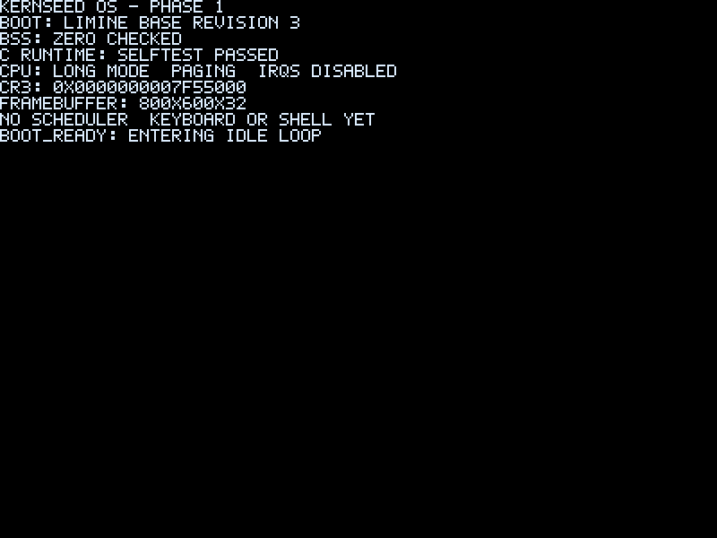
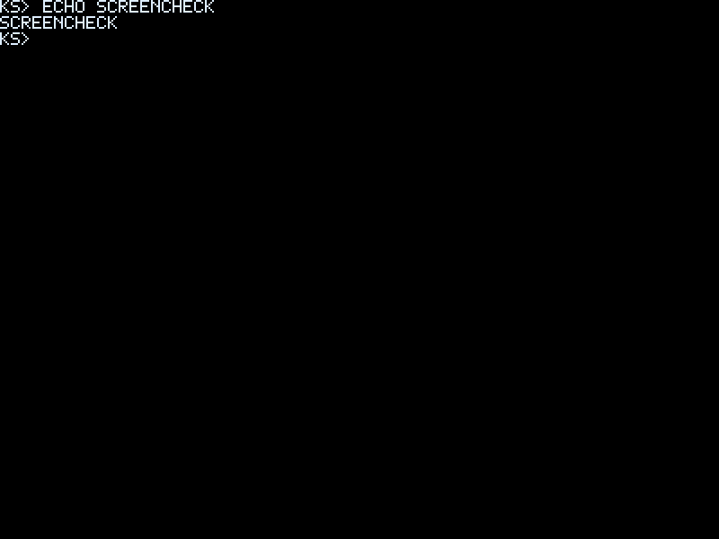

# Kernseed OS

Status: Completed — No active development or regular maintenance planned.

[English](README.md) | [简体中文](README.zh-CN.md)

An educational x86-64 monolithic operating system implemented primarily in freestanding C and assembly, led by OpenAI Codex with founder review and acceptance. For learners with basic C and architecture knowledge; not a Linux distribution or production OS.

## Implemented features

Limine boot, GDT/TSS/IDT and real exceptions, PIC/PIT, physical frames and controlled virtual mappings, preemptive kernel tasks, PS/2 keyboard and modular Shell, INT0x82 syscalls, minimal Ring3 and separately built embedded Hello/Counter apps. QEMU/GDB scripts and reproducible-build checks accompany the source.

## Quick start

```sh
git clone https://github.com/Evan-Windproof/Kernseed_OS.git
cd Kernseed_OS
sudo sh scripts/setup-host.sh
make deps
make -j2 iso check
make run
```
At `ks>` type help, apps, run hello or run counter. For VMware mount the ISO in a single-CPU VM; see the platform guide.

[Getting started](docs/en/getting-started.md) · [VMware](docs/en/vmware.md)

## Screenshots

Historical real captures: Phase1 boot and Phase5 Shell, not screenshots of the final Ring3 revision. No verified user-app or VMware image is available in the repository.





## Documentation

[Learning guide](docs/en/index.md) · [Commands](docs/en/command-reference.md) · [Shell extension](docs/en/extending-the-shell.md) · [Application development](docs/en/app-development.md)

## Limitations

Single CPU; below4GiB usable RAM; one active fixed user image with shared CR3. No general ELF loader, filesystem, dynamic linking, Linux/POSIX ABI, FPU/SIMD context or production safety guarantee. UART is output-only.

[Details](docs/en/limitations.md)

## Release and maintenance

Phases1–7 are complete. The founder reports a published release and basic QEMU/VMware acceptance. Release API access was Forbidden during this rewrite, so no exact version is asserted; use the releases page. Long-term feature maintenance is not planned; documentation, teaching examples and necessary fixes may precede final archival. This change publishes nothing and archives nothing.

[Releases](https://github.com/Evan-Windproof/Kernseed_OS/releases)

## License

Source-available under [PolyForm Noncommercial1.0.0](LICENSE). Commercial use is restricted; this is not OSI Approved Open Source. Third-party components retain their licenses: [notices](THIRD_PARTY_LICENSES.md). Educational/experimental use only; do not use for production or important data.

### Minimum RAM Experiment

Kernseed OS was tested under QEMU with a single virtual CPU and TCG acceleration.

The lowest tested configuration that successfully booted into the interactive shell and executed an embedded Ring 3 userspace application was **6 MiB RAM**.

Configurations with 5 MiB and 4 MiB failed during Limine's executable loading process with a `High memory allocator: Out of memory` error.

These results apply to the tested Phase 7 build and QEMU configuration. They do not establish a universal minimum memory requirement or guarantee long-term stability under low-memory conditions.
