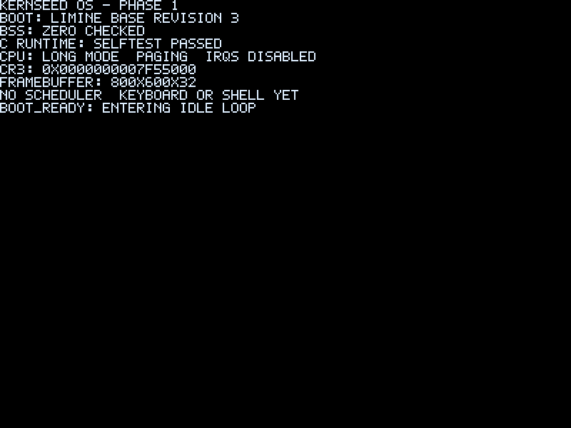
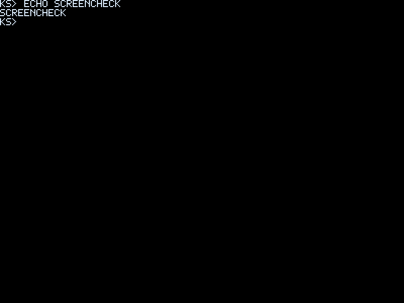

# Kernseed OS

[English](README.md) | [简体中文](README.zh-CN.md)

面向教学的独立x86-64宏内核，主要使用freestanding C和汇编，由OpenAI Codex主导实现，发起人监督与验收。适合学习C、体系结构和内核机制，不是Linux发行版或生产系统。

## 已实现功能

Limine引导、GDT/TSS/IDT和真实异常、PIC/PIT、物理页框和受控虚拟映射、抢占式内核任务、PS/2键盘与模块化Shell、INT0x82系统调用、最小Ring3及独立构建的内置Hello/Counter应用，附QEMU/GDB脚本和可复现构建检查。

## Quick start

```sh
git clone https://github.com/Evan-Windproof/Kernseed_OS.git
cd Kernseed_OS
sudo sh scripts/setup-host.sh
make deps
make -j2 iso check
make run
```
在`ks>`输入help、apps、run hello或run counter。VMware单CPU虚拟机挂载ISO，详见平台教程。

[Getting started](docs/zh-CN/getting-started.md) · [VMware](docs/zh-CN/vmware.md)

## Screenshots

仓库真实历史截图：Phase1引导与Phase5 Shell，并非最终Ring3版本截图。仓库没有可验证的用户应用或VMware截图。





## Documentation

[Learning guide](docs/zh-CN/index.md) · [Commands](docs/zh-CN/command-reference.md) · [Shell extension](docs/zh-CN/extending-the-shell.md) · [Application development](docs/zh-CN/app-development.md)

## 已知限制

仅单核、低于4GiB可用RAM；共享CR3且仅一个活跃固定用户映像。无通用ELF加载器、文件系统、动态链接、Linux/POSIX ABI、FPU/SIMD上下文或生产安全保证。UART仅输出。

[Details](docs/zh-CN/limitations.md)

## 发布与维护

Phase1–7已完成。发起人报告正式Release已发布并通过QEMU/VMware基本验收；本轮Release API查询Forbidden，无法独立核对精确版本，请查看发布页。不计划长期功能维护，归档前仍可能完善文档、教学示例与必要修复。本轮不发布或归档。

[Releases](https://github.com/Evan-Windproof/Kernseed_OS/releases)

## License

自有代码采用[PolyForm Noncommercial1.0.0](LICENSE)，属于source-available，商业使用受限，不是OSI Approved Open Source。第三方保留原许可，见[声明](THIRD_PARTY_LICENSES.md)。仅供教学实验，不用于生产或重要数据。
