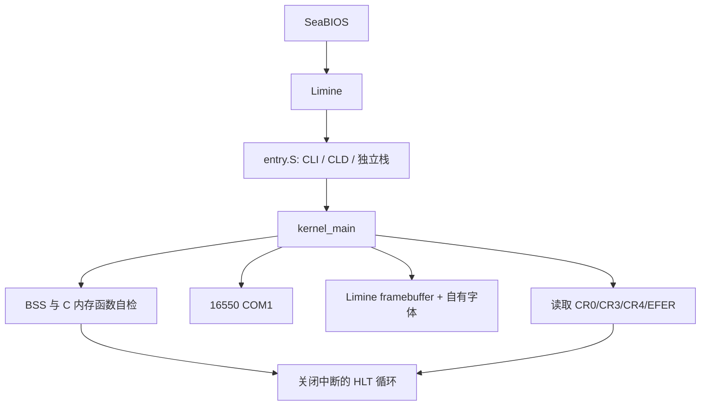

# 宏内核架构与开发计划

## 当前实现（Phase 1）

所有当前代码运行于 CPL0，共享 Limine 建立的地址空间。`console_write` 同时调用串口和
framebuffer，早期 framebuffer 未初始化时只输出串口。`runtime.c` 不依赖其他内核模块。
驱动不调用宿主系统服务；宿主进程只负责构建、模拟与检查。

## 后续依赖（均未实现）

| 阶段 | 前置依赖 | 预期交付与必须验收 |
|---|---|---|
| 1 引导 | freestanding 工具链、Limine | 实际镜像、串口、屏幕、ABI/长模式检查、重复冷启动 |
| 2 CPU/中断 | Phase 1 日志 | 自有 GDT/IDT、异常汇编桩、PIC、PIT；受控异常与真实 IRQ 计数 |
| 3 内存 | boot memmap/HHDM、中断异常 | 保留内核/引导区的页帧分配器，分配/释放检测，自有页表 API；映射写读及解除映射后的预期页故障 |
| 4 调度 | 内存、定时器、架构上下文 | TCB、独立栈、上下文保存/恢复；两个任务独立栈与进度证明 |
| 5 设备/Shell | IRQ、终端、任务接口 | PS/2 键盘、输入环形缓冲；真实输入及 help/clear/about/meminfo/tasks/uptime/reboot |
| 6 系统调用 | IDT、明确 ABI | 编号/参数/返回/错误边界；内核态调用测试，明确 CPL0 适用范围 |
| 7 集成 | 前述模块 | 完整回归、GDB、故障注入、重复启动、文档与许可复核 |

不为满足输出而伪造设备、任务和内存状态。每阶段先完成可测实现，再运行构建与 QEMU，
保留失败证据，修复后提交阶段报告。完整用户态隔离不是当前阶段成果。

## 约束

- 单核 x86-64、传统宏内核；不采用微内核或 Exokernel。
- 中断与调度前先定义共享状态保护；Phase 1 无并发输出支持。
- 只在硬件入口、寄存器操作和上下文切换处使用必要汇编。
- 未初始化内核 IDT 前不能 `sti`。不能回收 Limine 所用内存后继续依赖它的页表或响应。
- 当前不是安全边界完善的系统，不用于生产部署。
