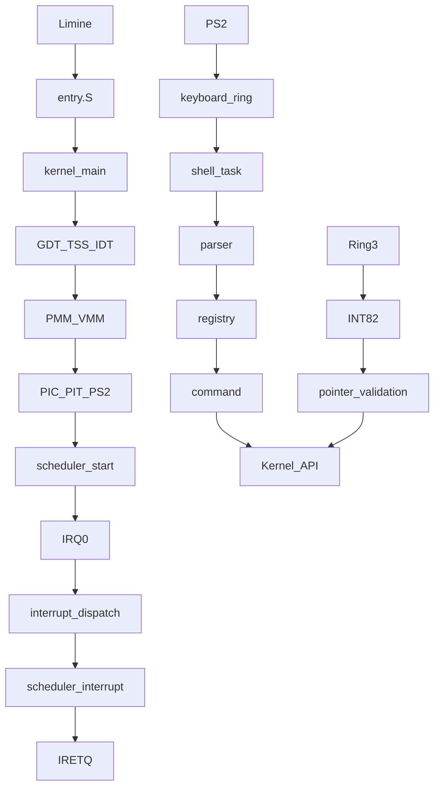

# Architecture

A kernel controls CPU, memory and devices. A monolithic kernel places these services in privileged kernel space. Kernseed uses separate source modules, not separate service processes. Shell is a kernel task; applications cross a hardware privilege boundary.

[Source / 源码](../../kernel/core/main.c) · [Index / 目录](index.md)

Kernel sources live under kernel/arch, core, drivers, interrupts, memory, scheduler and syscall; shell/commands contains independent command handlers. boot contains Limine config/linker layout, apps contains independent application sources, tests contains host and emulator checks. Shared CR3 retains kernel/HHDM mappings; only the dedicated VMM window is changed.
