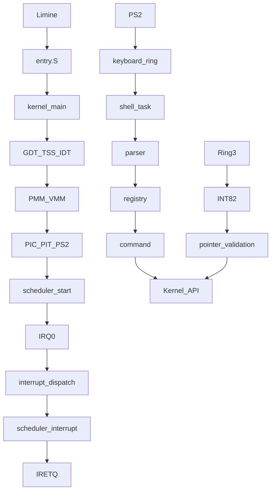

# 架构

内核管理 CPU、内存与设备。宏内核将这些服务置于特权内核空间；源码模块独立不代表服务进程隔离。Shell 是内核任务，应用则通过硬件特权级边界请求服务。

[Source / 源码](../../kernel/core/main.c) · [Index / 目录](index.md)

kernel下按arch、core、drivers、interrupts、memory、scheduler、syscall分模块；shell/commands为独立命令。boot保存引导配置/链接布局，apps保存独立应用源码，tests保存宿主与模拟器测试。共享CR3保留内核/HHDM，只修改专用VMM窗口。
